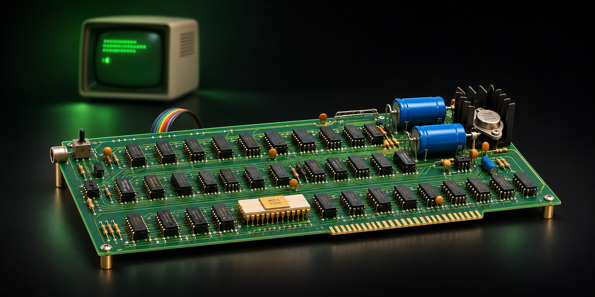

# Apple-1 Lab

An interactive introduction to the Apple-1: explore the board, build a simplified machine, and follow programs one instruction at a time.

**[Explore the live site](https://nicolashedoire.github.io/apple-1-lab-site/)**



The experience is in French and is designed for curious beginners. Pixel, a small pixel-art companion, welcomes visitors on the home page.

## Explore

- **[Explore the board in 3D](https://nicolashedoire.github.io/apple-1-lab-site/carte-3d.html):** rotate the model, select a component, and move between close-up views.
- **[Learn the basics](https://nicolashedoire.github.io/apple-1-lab-site/guide.html):** discover memory, the processor, and how a character reaches the screen.
- **[Build the machine](https://nicolashedoire.github.io/apple-1-lab-site/montage.html):** place simplified components in a guided 3D assembly workshop.
- **[Follow instructions](https://nicolashedoire.github.io/apple-1-lab-site/laboratoire.html):** step through example programs, watch registers and memory change, or arrange a small recipe of instructions.
- **[Experiment with memory](https://nicolashedoire.github.io/apple-1-lab-site/memoire.html):** change a byte in an isolated simulation and see its effect on a message.
- **[Investigate the monitor](https://nicolashedoire.github.io/apple-1-lab-site/enquete.html):** follow a letter through a simplified explanation of Wozniak's `ECHO` routine.
- **[Write your name](https://nicolashedoire.github.io/apple-1-lab-site/prenom.html):** turn a name into 6502 instructions and run them in the simulator.
- **[Keep a notebook](https://nicolashedoire.github.io/apple-1-lab-site/carnet.html):** revisit pages, explore a glossary, and collect badges for completed challenges.

The home-page diploma is an illustrative preview. The name activity currently offers a printable certificate after that activity succeeds; a final diploma requiring all activities to be completed has not yet been implemented. Opened-page progress and earned badges are stored separately in the browser on the current device.

## Run locally

The repository contains the static site itself. You need Python 3, a WebGL-capable browser for 3D, and an internet connection to load Three.js from its CDN. No package installation or build step is required.

```sh
git clone https://github.com/nicolashedoire/apple-1-lab-site.git
cd apple-1-lab-site
python3 -m http.server 8000
```

Open [http://localhost:8000](http://localhost:8000). Serve the files over HTTP rather than opening the HTML files directly, so JavaScript modules and assets load correctly. The multi-page site uses relative links and also works under the GitHub Pages project path.

## Historical and technical scope

This is an educational interpretation, not a manufacturing reference or a cycle-accurate emulator. The original manual provides circuit schematics, but not a complete printed-circuit-board layout; placement and traces in the 3D model are approximate. The assembly workshop is a simplified teaching exercise, not a guide to building physical hardware.

The simulator implements a subset of 6502 instructions. Input/output and the monitor's `ECHO` routine are simplified. One displayed step represents an instruction, not an electrical clock cycle, and `BRK` stops the demonstration rather than reproducing its full hardware behavior.

## Reference

Download the [Apple-1 Operation Manual (1976)](apple1-manual.pdf), including the circuit schematics and monitor listing.
